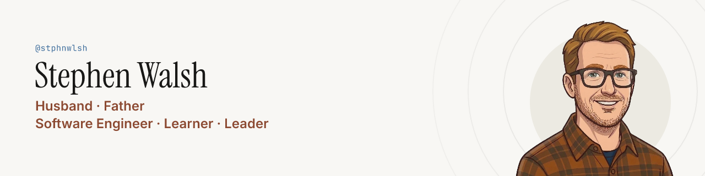
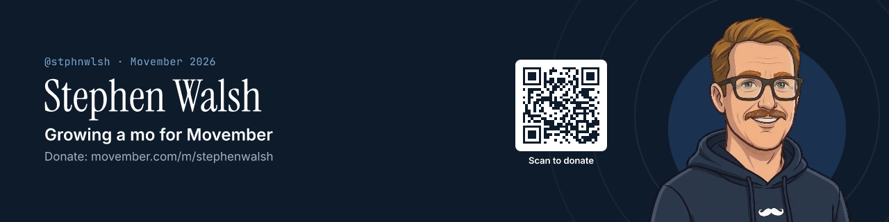

<!-- November: the Movember banner. The rest of the year: whichever look the mirror agrees with, paper in light mode and navy in dark mode, e.g.
<picture>
  <source media="(prefers-color-scheme: dark)" srcset="./brand/banners/stubble-navy/stubble-navy-github-readme-1280x320.png">
  
</picture>
-->

## Hello, I'm Stephen

**Husband · Father · Software Engineer · Mentor · Learner · Leader**

I'm a software engineering leader in Neenah, Wisconsin, by way of Australia, happiest where leading teams meets staying hands-on in the code. I look after Lean Mean Clean Apps, write the odd post about .NET and engineering careers, and grow a questionable moustache every November to raise money for Movember. The rest of the time I'm drinking coffee and trying to balance it all with being a husband and father. Say hi, I don't bite… often.

This November the razor is on holiday while I grow a mo for [Movember](https://movember.com/m/stephenwalsh). I've got more than one reason: my Dad, who won his fight against prostate cancer, my friend Bryan, who's in remission after his, and Derrick and Sean, who went far too soon. If you'd like to help change the face of men's health, every donation counts, and the mo needs all the encouragement it can get.

## What I tinker with

[Lean Mean Clean Apps](https://leanmeancleanapps.github.io) is what I build when the kids are asleep: five `dotnet new` templates with a low-ceremony take on Clean Architecture. Fewer layers than an onion, more than a sandwich. No investors, no roadmap deck, just a small team (me) having fun and giving it away.

- [Clean Minimal API](https://github.com/LeanMeanCleanApps/CleanMinimalApi): an ASP.NET Core Minimal API
- [Clean Model Context Protocol](https://github.com/LeanMeanCleanApps/CleanModelContextProtocol): an MCP server on the official C# SDK
- [Clean GraphQL API](https://github.com/LeanMeanCleanApps/CleanGraphQLApi): a GraphQL API on Hot Chocolate
- [Clean Web API](https://github.com/LeanMeanCleanApps/CleanWebApi): an ASP.NET Core Web API with controllers
- [Clean Lambda Function](https://github.com/LeanMeanCleanApps/CleanLambdaFunction): an AWS Lambda function shipped as a container image

## Things I've written

Every so often I have an opinion too long for a Slack message. These are the ones people actually read.

- [Full Stack Engineers Don't Exist!](https://medium.com/better-programming/full-stack-engineers-dont-exist-37afb7a6b26c) in Better Programming
- [Making Software Engineering Interviews More Creative and Interesting](https://medium.com/@stphnwlsh/making-software-engineering-interviews-more-creative-and-interesting-f25a9f001a2)
- [A Cleaner Startup for .NET 6's Minimal Approach](https://medium.com/itnext/a-cleaner-startup-for-net-6s-minimal-approach-c1c05a672c6a) in ITNEXT, where the Clean Minimal API started
- [Bending DateTime in .NET 8 to Test Your Code Better](https://medium.com/gitconnected/bending-datetime-in-net-8-to-test-your-code-better-52e5cd83be4c) in Level Up Coding

## Find me elsewhere

[LinkedIn](https://www.linkedin.com/in/stphnwlsh/) · [Medium](https://stphnwlsh.medium.com/) · [Personal Website](https://stphnwlsh.github.io) · [GitHub Sponsors](https://github.com/sponsors/stphnwlsh)

The banner, avatars and the rest of the look live in my [brand kit](./brand). Yes, even my face has a build script.
