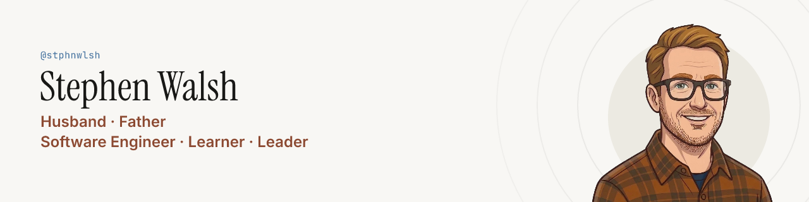
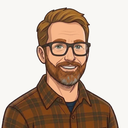
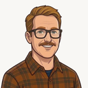
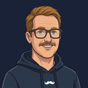
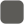
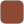

# Brand kit

Everything that makes me look like the same person on every site: the avatars, a banner for every profile header, the Movember posts, the SW monogram, colours, type and the words. All of it is built from source with a couple of commands, so nobody (me) has to nudge pixels in an image editor at 11pm.

## The looks

Same face, same hair, same glasses. Only the facial hair changes, and in November the flannel makes way for the hoodie. Pick whichever one matches the mirror.

| | Look | Key | When |
| --- | --- | --- | --- |
|  | Stubble | `stubble` | Most of the year. The default. |
|  | Clean shaven | `clean` | Fresh shave, or 1 November before the mo gets going. |
|  | Short beard | `beard` | Wisconsin winters. It's a warmth thing. |
|  | Moustache | `moustache` | The mo in everyday clothes. |
|  | Movember | `movember` | The campaign look. Its banners carry the donate link and QR code. |

## What goes where

Swap `<look>` for one of the keys above and `<theme>` for `paper` (light) or `navy` (dark).

| Where | File |
| --- | --- |
| GitHub, Medium, Gravatar, NuGet and most other profile pictures | `avatars/profile/<look>-<theme>-512.png` |
| GitHub profile README | `banners/<look>-paper/…-github-readme-1280x320.png` and `banners/<look>-navy/…-github-readme-1280x320.png` together in a `<picture>`, so dark mode gets navy (see the profile README) |
| LinkedIn banner | `banners/<look>-navy/<look>-navy-linkedin-1584x396.png` (paper melts into LinkedIn's off-white page) |
| X and Bluesky header | `banners/<look>-<theme>/<look>-<theme>-social-header-1500x500.png` |
| GitHub Sponsors intro | `banners/sponsors/sponsors-<look>-1280x256.png` (me plus the Lean Mean Clean Apps logos, shorter than a profile banner; the LMCA logos are copies in `logos/lmca/` from LeanMeanCleanApps/brand) |
| Medium profile header | `banners/medium/medium-header-navy-3000x450.png` (no face or name, because Medium shows both under it; `paper` works too) |
| Link previews (Open Graph) | `banners/<look>-<theme>/<look>-<theme>-social-card-1200x630.png` |
| November, any of the above | `banners/movember/movember-<size>.png`, and `banners/medium/medium-header-movember-3000x450.png` on Medium |
| Facebook and Instagram in November | `movember-posts/` (no cartoon, just the ask and the QR code) |
| Anywhere else that needs the donate link | `movember-posts/movember-donate-qr.svg` |
| Website | `avatars/webp/`, `avatars/transparent/`, `logos/`, `tokens/tokens.css` |
| Website favicon in November | `logos/favicon-movember.svg` and its PNGs (the moustache on Movember navy) |

LinkedIn, X and Bluesky park the profile photo over the bottom left of the banner, so those banners keep their words further to the right.

## Sizing

Every site shrinks its banner, so the type is sized for the screen, not the file. Each size in `build/build.mjs` records roughly how wide it's shown on a desktop (GitHub about 840px, LinkedIn 800, X and Bluesky 600, link previews 500), and the build stops with an error if any text would land under these sizes on screen:

| Text | At least |
| --- | --- |
| Name | 36px |
| Tagline and Movember headline | 16px |
| Handle, site address and the Movember link | 12px |

The wide banners run the tagline as two lines of three. The X/Bluesky header and the link card are taller, so they get three lines of two at a bigger size. Phones shrink everything again, and that's fine: by then the face and name are doing the work.

## Colours

| | Name | Hex | Used for |
| --- | --- | --- | --- |
|  | Paper | `#F8F7F4` | Light background |
|  | Paper raised | `#ECEAE2` | The disc behind the avatar on paper |
|  | Ink | `#181816` | Text on paper |
|  | Ink muted | `#5C5B57` | Secondary text on paper |
|  | Navy | `#1A2238` | Dark background |
|  | Navy raised | `#222C47` | The disc behind the avatar on navy |
|  | Navy muted | `#A6B0C3` | Secondary text on navy |
|  | Movember navy | `#0E1B2A` | November only |
|  | Rust | `#8C4A32` | The tagline on paper. Borrowed from the flannel. |
|  | Rust on dark | `#D69A78` | The tagline on navy |
|  | Blue | `#3F6E9C` | Handle and links on paper |
|  | Blue on dark | `#7CA9D4` | Handle and links on navy |

The same values live in [`tokens/tokens.json`](./tokens/tokens.json) (the build reads them from there) and [`tokens/tokens.css`](./tokens/tokens.css) (for the website, with light and dark themes). The JSON also holds the character palette, so any future redraw keeps the hair the same colour in every look. It took a while to get there.

## Type

- **Instrument Serif** for the name and headlines.
- **Inter** for everything else. The tagline is Inter SemiBold.
- **JetBrains Mono** for the `@stphnwlsh` handle chip (SemiBold, on a soft tint of the handle blue) and the site address.

All three are free under the SIL Open Font License. Copies of the fonts and their licences are in [`build/fonts/`](./build/fonts).

## Words

- **Name:** Stephen Walsh
- **Handle:** `@stphnwlsh` everywhere. No vowels were harmed; they just weren't invited.
- **LinkedIn headline:** Software Engineering Leader
- **Tagline:** Husband · Father · Software Engineer · Mentor · Learner · Leader. The wide banners split it after "Software Engineer"; the X/Bluesky header and the link card use three lines of two.
- **Bios:** short, medium and long versions, plus why I grow a mo, live in [bios.md](bios.md). The GitHub bio is the short one.
- **Profiles:** the LinkedIn About and the GitHub Sponsors page, with their settings, live in [profiles/](profiles/README.md). Change them there first, then paste them across.

## Movember

Donations go to [movember.com/m/stephenwalsh](https://movember.com/m/stephenwalsh). Every Movember banner and post asks people to "Please give" in the handle blue, the loudest line after the name. Where the image can't be clicked there's a "Scan to give" QR code too, 48px from the words. The GitHub README banner skips it, because the whole banner is the link. The posts keep their footers clear of Instagram's reply bar and Facebook's profile photo. Before each November, bump `movemberYear` in `tokens/tokens.json` and rebuild.

## Rebuilding

New avatar art goes in `avatars/source/` as a 1024×1024 PNG on a flat, light background, named after its look. Then:

```bash
pip install pillow numpy opencv-python-headless fonttools
python3 brand/build/avatars.py               # transparent cut-outs, profile pictures, WebP
python3 brand/build/logos.py                 # SW monogram and favicon SVGs
cd brand/build && npm ci && npm run build    # banners, Movember posts, QR code, PNG icons
```

The build wipes and rewrites `banners/` and `movember-posts/`, so change the scripts or the tokens, not the PNGs. If a change pushes any text under the on-screen sizes above, or a QR code into the avatar, the build stops and says which banner.

## About the art

The cartoon me is an AI-assisted illustration, redrawn many, many times until the hair stopped changing colour between looks. The reference photos stay off the internet on purpose.
